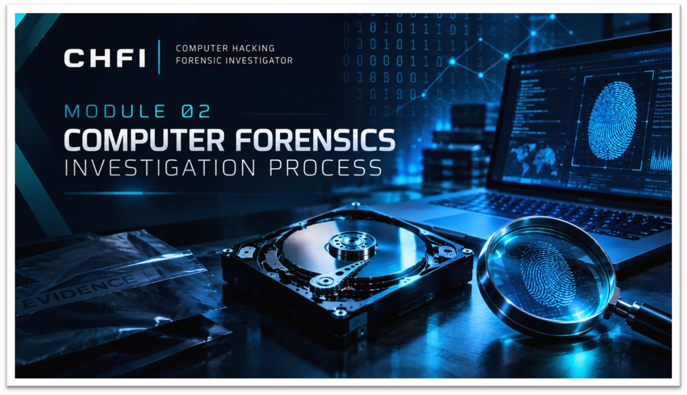

  

<h1>Module 02 — Computer Forensics Investigation Process</h1>
<h3>Recovery, Hashing and Forensic Imaging of a Formatted USB Drive Across Six Labs</h3>

 

  

<a href="#evidence-and-case"><b>Evidence</b></a> &nbsp;·&nbsp;
<a href="#lab-walkthrough"><b>Labs</b></a> &nbsp;·&nbsp;
<a href="#chain-of-custody"><b>Chain of Custody</b></a> &nbsp;·&nbsp;
<a href="#key-takeaways"><b>Takeaways</b></a> &nbsp;·&nbsp;
<a href="#full-report"><b>Full Report</b></a>

 

---

## Executive Summary

This module documents a complete forensic investigation of a formatted 32 GB Samsung USB drive, from data recovery and hashing through deep analysis to a verified forensic image. Six labs cover the full process using **EaseUS, Autopsy, HxD, ExifTool, FTK Imager and VirusTotal**.

Chain of custody was maintained throughout, hash values were recorded with multiple algorithms, and the original media was never modified.

> All work was performed on lab evidence for educational purposes. Only the reports are published in this repository.

 

## Evidence and Case

<table>
<tr><th>Item</th><th>Detail</th></tr>
<tr><td><b>Subject</b></td><td>Formatted 32 GB Samsung USB drive</td></tr>
<tr><td><b>Case ID</b></td><td><code>CHFI_Module2_Lab1to5_Case001</code></td></tr>
<tr><td><b>Hash Algorithms</b></td><td>MD5, SHA-1, SHA-256, SHA-512</td></tr>
<tr><td><b>Evidence Items</b></td><td>EV-001 original USB drive, EV-002 recovered files</td></tr>
</table>

 

## Lab Walkthrough

<table>
<tr><th>Lab</th><th>Focus</th><th>Tool</th><th>Outcome</th></tr>
<tr><td><b>1</b></td><td>Data recovery</td><td><code>EaseUS</code></td><td>About 2 GB of files recovered from the formatted drive</td></tr>
<tr><td><b>2</b></td><td>Hashing and malware check</td><td><code>VirusTotal</code></td><td>Files hashed with four algorithms; <code>Infected.pdf</code> flagged as a trojan by 44 of 62 engines</td></tr>
<tr><td><b>3</b></td><td>File integrity</td><td>Hash comparison</td><td>Integrity demonstrated by comparing hash values</td></tr>
<tr><td><b>4</b></td><td>Deep analysis</td><td><code>Autopsy</code> <code>HxD</code> <code>ExifTool</code></td><td>5 critical findings identified</td></tr>
<tr><td><b>5 – 6</b></td><td>Evidence handling and imaging</td><td><code>FTK Imager</code></td><td>Evidence handled in FTK Imager and a verified E01 forensic image created</td></tr>
</table>

**Investigation flow:** recover deleted data → hash and scan every file → verify integrity → analyse with multiple tools → acquire a verified forensic image.

 

## Chain of Custody

The evidence record for Labs 1 to 5 covers the following.

<table>
<tr><th>Item</th><th>Detail</th></tr>
<tr><td><b>Evidence</b></td><td>EV-001 original USB drive, EV-002 recovered files</td></tr>
<tr><td><b>Derived Items</b></td><td>Working copies, FTK source and exported evidence</td></tr>
<tr><td><b>Records</b></td><td>Transfer log, storage locations and access controls</td></tr>
<tr><td><b>Verification</b></td><td>Hash values recorded with MD5 and SHA-256</td></tr>
<tr><td><b>Final Disposition</b></td><td>Retained for Lab 6 imaging</td></tr>
</table>

 

## Key Takeaways

- **Hash everything.** Recording MD5, SHA-1, SHA-256 and SHA-512 values lets any later copy be verified against the original.
- **Formatting is not erasure.** About 2 GB of data was recovered from a formatted drive.
- **Never touch the original.** Analysis was done on recovered and working copies, and the final image was created and verified in FTK Imager.
- **Documentation is part of the evidence.** The chain of custody record is what makes the findings defensible.

 

## Lab Environment

| | |
|---|---|
| **Tools Used** | `EaseUS` `Autopsy` `HxD` `ExifTool` `FTK Imager` `VirusTotal` |
| **Hashes** | MD5, SHA-1, SHA-256, SHA-512 |
| **Image Format** | E01 |
| **Published Material** | Reports only |

 

## Full Report

The lab report and the chain of custody record are available here:

📄 **[Lab-Report.pdf](./Lab-Report.pdf)**
📄 **[Chain-of-Custody.pdf](./Chain-of-Custody.pdf)**

 

## Disclaimer

This work was carried out for educational purposes under the EC-Council CHFI curriculum. Disk images, recovered files and malware samples are not published in this repository.

 

⬅ <a href="../"><b>Back to Main Repository</b></a>

