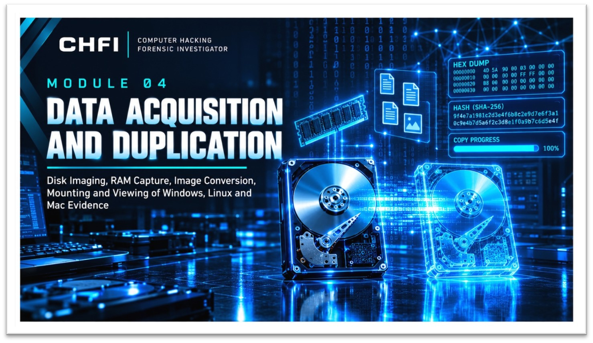

  

# Module 04: Data Acquisition and Duplication

### The full acquisition pipeline, from live memory to forensic images

[Back to portfolio](../README.md) · [Lab report (PDF)](./Lab-Report.pdf)

---

## Overview

Hands-on labs covering the acquisition pipeline: imaging disks, converting and mounting images, capturing RAM and reading images through scripts. The labs follow the order of volatility, verify images with hashes and never modify the original evidence.

|                  |                                                                                          |
| ---------------- | ---------------------------------------------------------------------------------------- |
| **Image types**  | Windows images and Mac HFS+ images                                                       |
| **Tools**        | `dd` `xmount` `FTK Imager` `DiskExplorer` `Belkasoft` `fmem` `LiME` `netcat` `pytsk3`    |

## Labs

| Lab                              | What was done                                                              |
| -------------------------------- | -------------------------------------------------------------------------- |
| Disk imaging                     | Imaging with `dd` on Windows                                               |
| Image conversion                 | E01 to raw conversion with `xmount`                                        |
| Read-only mounting               | Windows and Mac HFS+ images mounted read-only                              |
| RAM acquisition                  | Memory captured with Belkasoft, fmem, LiME and netcat                      |
| Custom imaging                   | Disk image created with DiskExplorer                                       |
| Image viewing                    | Images opened and browsed in FTK Imager                                    |
| Scripted access                  | Image contents read with Python and `pytsk3`                               |

## Principles Applied

| Principle                  | Meaning                                                                  |
| -------------------------- | ------------------------------------------------------------------------ |
| Order of volatility        | Capture the most volatile data first                                     |
| Hashing                    | Verify every image against the source                                    |
| Original evidence intact   | Work on images and mount them read-only                                  |
