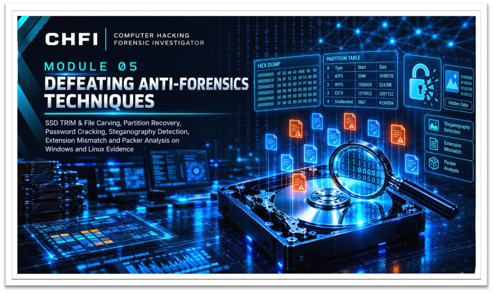

  

<h1>Module 05 — Defeating Anti-Forensics Techniques</h1>
<h3>Identifying and Countering Techniques Used to Hide or Destroy Evidence</h3>

 

  

<a href="#lab-walkthrough"><b>Labs</b></a> &nbsp;·&nbsp;
<a href="#key-takeaways"><b>Takeaways</b></a> &nbsp;·&nbsp;
<a href="#lab-environment"><b>Environment</b></a> &nbsp;·&nbsp;
<a href="#full-report"><b>Full Report</b></a>

 

---

## Executive Summary

This module documents eight practical labs on deliberate anti-forensic techniques and the methods used to detect or defeat them: **SSD TRIM, partition deletion, credential extraction, password protection, steganography, extension mismatch and executable packing**.

All analysis was read-only. Recovered or decrypted artifacts were written to separate export folders so the original evidence stayed unmodified.

> All work was performed on lab evidence for educational purposes. Only the report is published in this repository.

 

## Lab Walkthrough

<table>
<tr><th>#</th><th>Technique</th><th>Outcome</th></tr>
<tr><td><b>1</b></td><td>SSD TRIM anti-carving (Windows)</td><td>TRIM enabled: no recoverable files. TRIM disabled: deleted files (a GIF and a text file) carved successfully</td></tr>
<tr><td><b>2</b></td><td>SSD TRIM anti-carving (Linux)</td><td>Same behaviour confirmed; with TRIM off the deleted files were recovered</td></tr>
<tr><td><b>3</b></td><td>Partition deletion and merge concealment</td><td>Deleted partition fully recovered with an <code>R-Studio</code> detailed sector scan, including <code>Infected.exe</code> and <code>Confidential.pdf</code></td></tr>
<tr><td><b>4</b></td><td>Credential extraction</td><td><code>pwdump7</code> extracted LM and NTLM hashes from the live SAM database</td></tr>
<tr><td><b>5</b></td><td>Application password cracking</td><td>Password-protected PDF, RAR and Word files opened with <code>Passware Kit Forensic</code>, <code>Advanced Archive Password Recovery</code> and <code>Advanced PDF Password Recovery</code></td></tr>
<tr><td><b>6</b></td><td>Steganography detection</td><td>Hidden data found and extracted from images (<code>StegSpy</code>, <code>OpenStego</code>, <code>zsteg</code>) and audio (<code>DeepSound</code>)</td></tr>
<tr><td><b>7</b></td><td>File extension mismatch</td><td><code>Autopsy</code>'s Extension Mismatch Detector found files whose content did not match their extension, such as a JPEG disguised as <code>.trace</code></td></tr>
<tr><td><b>8</b></td><td>Executable packing</td><td><code>Detect It Easy</code> and <code>Exeinfo PE</code> identified packing and obfuscation on <code>Infected.exe</code></td></tr>
</table>

 

## Key Takeaways

- **TRIM changes what is recoverable.** With TRIM enabled no files could be carved; with it disabled they were recovered on both Windows and Linux.
- **A deleted partition is not a lost partition.** A detailed sector scan recovered the full partition and its files.
- **Anti-forensics mostly changes the surface.** Techniques alter metadata, structure or appearance, so the countermeasure is to inspect the underlying bytes: file signatures, entropy and raw sectors.
- **Do not trust names.** File names, extensions and the live partition table can all be misleading.

 

## Lab Environment

| | |
|---|---|
| **Labs** | 8 |
| **Tools Used** | `R-Studio` `pwdump7` `Passware Kit Forensic` `Advanced Archive Password Recovery` `Advanced PDF Password Recovery` `StegSpy` `OpenStego` `zsteg` `DeepSound` `Autopsy` `Detect It Easy` `Exeinfo PE` |
| **Method** | Read-only analysis, separate export folders |
| **Published Material** | Report only |

 

## Full Report

The complete lab report is available here:

📄 **[Lab-Report.pdf](./Lab-Report.pdf)**

 

## Disclaimer

This work was carried out for educational purposes under the EC-Council CHFI curriculum. Malware samples, recovered files and extracted credentials are not published in this repository.

 

⬅ <a href="../"><b>Back to Main Repository</b></a>

