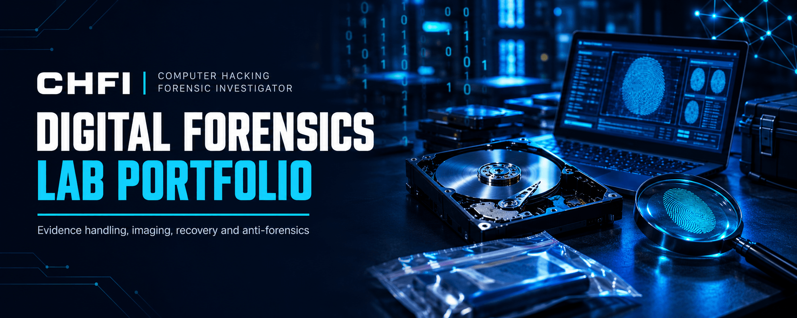

<p align="center">
  
</p>

<h1 align="center">Computer Hacking Forensic Investigator Lab Portfolio</h1>

<h3 align="center">Hands-on CHFI modules: investigation process, file systems, data acquisition and anti-forensics</h3>

<p align="center">
  
  
  
  
</p>

<p align="center">
  <a href="#overview"><b>Overview</b></a> ·
  <a href="#modules"><b>Modules</b></a> ·
  <a href="#key-results"><b>Key Results</b></a> ·
  <a href="#evidence-handling"><b>Evidence Handling</b></a> ·
  <a href="#repository-structure"><b>Structure</b></a> ·
  <a href="#contact"><b>Contact</b></a>
</p>

---

## Overview

This repository documents my practical work for the EC-Council Computer Hacking Forensic Investigator (CHFI) curriculum. Each completed module has its own folder with a README covering the labs, the tools used and the key findings, together with the lab report as a PDF. Modules 02 and 03 also include the chain-of-custody record. Modules are added as I complete them.

|                         |                                                                                     |
| ----------------------- | ----------------------------------------------------------------------------------- |
| **Certification**       | EC-Council Computer Hacking Forensic Investigator (CHFI)                            |
| **Completed**           | Modules 02 to 05 (practical work)                                                   |
| **Evidence handling**   | Original evidence left unmodified, analysis done read-only or on verified copies    |
| **Documentation**       | Lab report for every module, chain-of-custody records for Modules 02 and 03         |
| **Platforms**           | Windows and Linux, with Mac HFS+ images examined in Module 04                       |
| **Format**              | One folder per module, each with its own `README.md`                                |

## Modules

| #  | Module                                                                                       | Focus                                                                             | Core Tools                                                                       |
| -- | -------------------------------------------------------------------------------------------- | --------------------------------------------------------------------------------- | -------------------------------------------------------------------------------- |
| 02 | [Computer Forensics Investigation Process](./02-Computer-Forensics-Investigation-Process/README.md) | Data recovery, hashing, integrity, evidence handling and forensic imaging of a formatted USB drive | `EaseUS` `Autopsy` `HxD` `ExifTool` `FTK Imager` `VirusTotal`                    |
| 03 | [Understanding Hard Disks and File Systems](./03-Hard-Disks-and-File-Systems/README.md)      | File system structure, deleted data recovery, timeline analysis, signature checks | `WinHex` `PhotoRec` `mactime`                                                    |
| 04 | [Data Acquisition and Duplication](./04-Data-Acquisition-and-Duplication/README.md)          | Disk imaging, image conversion and mounting, RAM acquisition, scripted image access | `dd` `xmount` `FTK Imager` `DiskExplorer` `Belkasoft` `LiME` `pytsk3`            |
| 05 | [Defeating Anti-Forensics Techniques](./05-Defeating-Anti-Forensics-Techniques/README.md)   | SSD TRIM, deleted partitions, password cracking, steganography, extension mismatch, packing | `R-Studio` `pwdump7` `Passware Kit Forensic` `OpenStego` `DeepSound` `Autopsy` `Detect It Easy` |

## Key Results

| Module                         | Result                                                                                                                              |
| ------------------------------ | ----------------------------------------------------------------------------------------------------------------------------------- |
| 02 Investigation Process       | About 2 GB recovered from a formatted 32 GB USB drive, a trojan-flagged PDF detected by 44 of 62 VirusTotal engines, a verified E01 image created |
| 03 Hard Disks and File Systems | 22 deleted files recovered with timestamps from a 2 GiB NTFS volume, all three disk images verified with SHA-256                     |
| 04 Data Acquisition            | Windows and Mac HFS+ images acquired, converted and mounted read-only, RAM acquired with several tools                               |
| 05 Anti-Forensics              | No deleted files recoverable with TRIM enabled, successful carving with TRIM disabled, a deleted partition fully recovered           |

## Evidence Handling

| Principle                    | How it was applied                                                                     |
| ---------------------------- | -------------------------------------------------------------------------------------- |
| **Order of volatility**      | Volatile data (RAM) acquired before disk imaging in the acquisition labs               |
| **Hash verification**        | Images and exported evidence hashed and re-verified (SHA-256, MD5, SHA-1, SHA-512 as required) |
| **Read-only analysis**       | Originals never modified, recovered artifacts written to separate export folders       |
| **Chain of custody**         | Transfer log, storage locations, access controls and hash values recorded for Modules 02 and 03 |

| Module | Case ID                        | Evidence items                                                                              |
| ------ | ------------------------------ | ------------------------------------------------------------------------------------------- |
| 02     | `CHFI_Module2_Lab1to5_Case001` | EV-001 original USB drive, EV-002 recovered files, working copies and exported evidence     |
| 03     | `CASE-2026-M3`                 | EV-001 Ext4 image, EV-002 NTFS volume image, EV-003 MBR disk with two NTFS partitions       |

## Repository Structure

```
computer-hacking-forensic-investigator-lab-portfolio/
├── README.md
├── LICENSE
├── images/
│   └── banner.png
│
├── 02-Computer-Forensics-Investigation-Process/
│   ├── README.md
│   ├── Lab-Report.pdf
│   ├── Chain-of-Custody.pdf
│   └── images/
│       └── cover.png
├── 03-Hard-Disks-and-File-Systems/
│   ├── README.md
│   ├── Lab-Report.pdf
│   ├── Chain-of-Custody.pdf
│   └── images/
│       └── cover.png
├── 04-Data-Acquisition-and-Duplication/
│   ├── README.md
│   ├── Lab-Report.pdf
│   └── images/
│       └── cover.png
└── 05-Defeating-Anti-Forensics-Techniques/
    ├── README.md
    ├── Lab-Report.pdf
    └── images/
        └── cover.png
```

## License

**© 2026 Abdul Wahid**. Licensed under [**CC BY-NC-ND 4.0**](./LICENSE) (Attribution, NonCommercial, NoDerivatives). You may view, reference and share a link to this work with credit. Commercial use and redistributing modified copies are not permitted.

## Disclaimer

All labs were carried out for study under the CHFI curriculum. Disk images, recovered files, memory dumps and malware samples are not included in this repository, only the lab reports and chain-of-custody records.

## Contact

<p align="center">
  <b>Abdul Wahid</b><br/>
  Computer Hacking Forensic Investigator (CHFI) Candidate — EC-Council
</p>

<p align="center">
  <a href="mailto:a.wahid7860668@gmail.com"></a>
  <a href="https://www.linkedin.com/in/abdul-wahid022"></a>
  <a href="https://github.com/abdul-wahid022"></a>
</p>
